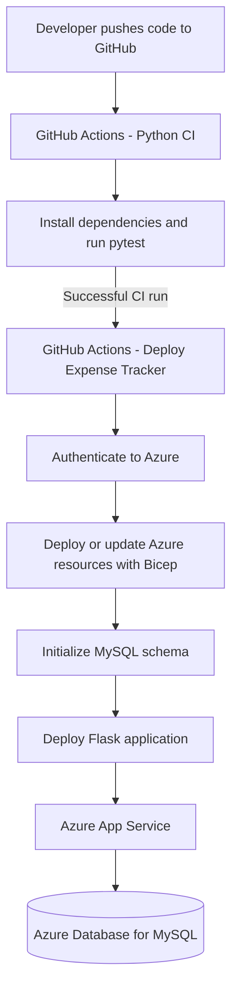
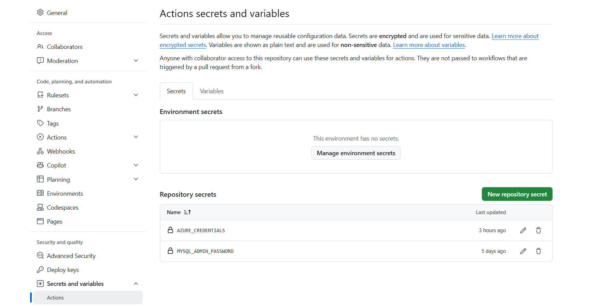
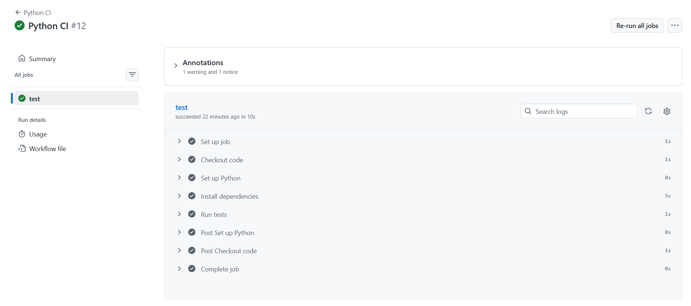
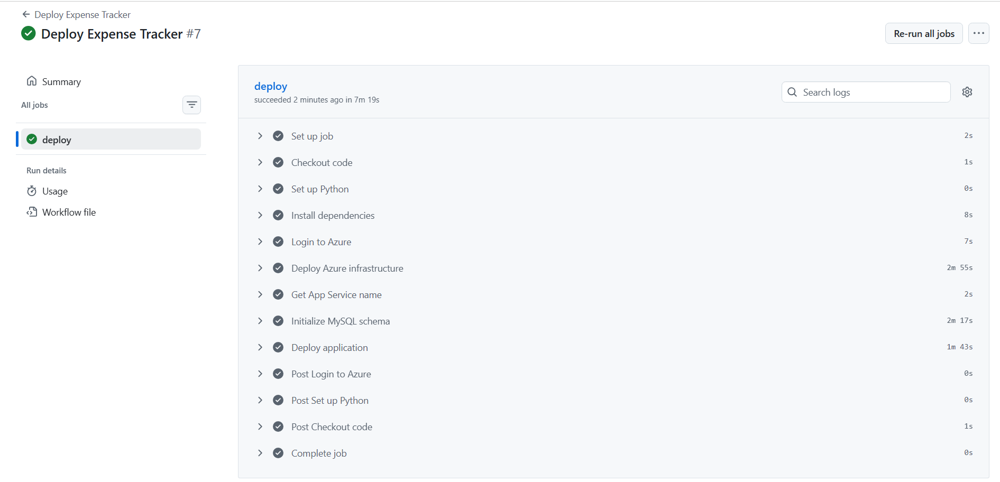
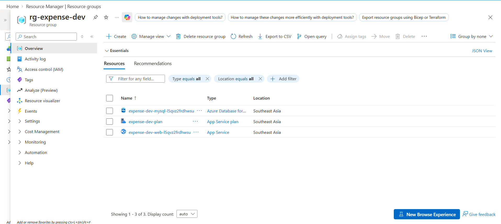
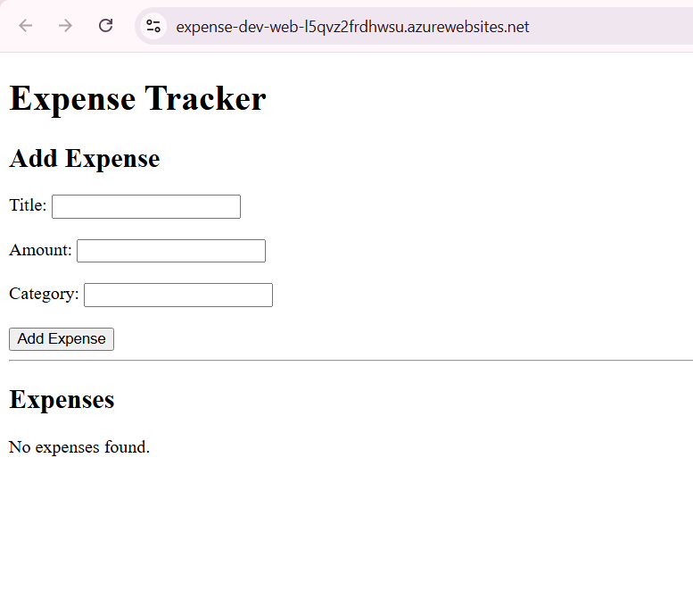
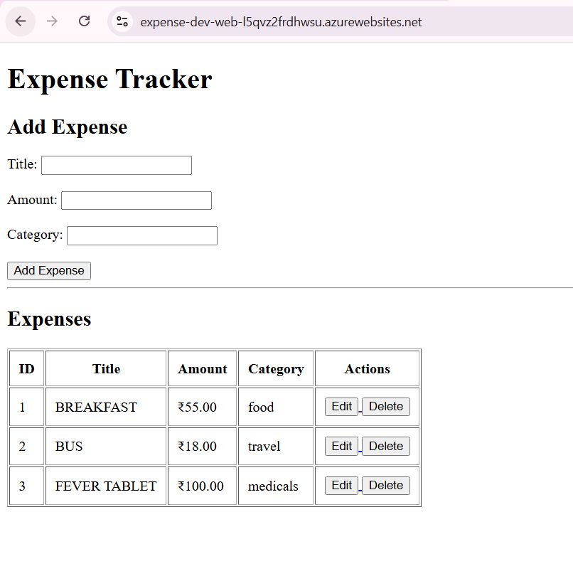

# GitHub Actions + Azure CI/CD Expense Tracker

A Python Flask Expense Tracker deployed to Microsoft Azure using **GitHub Actions for CI/CD** and **Bicep for Infrastructure as Code**. The application stores expense records in Azure Database for MySQL and is hosted on Azure App Service.

This project demonstrates how application testing, cloud infrastructure deployment, database initialization, and application deployment can be automated through GitHub Actions.

## Table of Contents

- [Project Overview](#project-overview)
- [Key Features](#key-features)
- [Technology Stack](#technology-stack)
- [Architecture](#architecture)
- [CI/CD Workflow](#cicd-workflow)
- [Azure Resources](#azure-resources)
- [Repository Structure](#repository-structure)
- [GitHub Actions Secrets](#github-actions-secrets)
- [Application Screenshots](#application-screenshots)
- [Run Locally](#run-locally)
- [Security Notes](#security-notes)
- [Cost and Cleanup](#cost-and-cleanup)

## Project Overview

The Expense Tracker is a small web application for recording and managing expenses. The main focus of this project is the **automated deployment workflow**, rather than application complexity.

The GitHub Actions workflow runs tests and, after successful CI, triggers a deployment workflow. The deployment workflow provisions or updates Azure resources with Bicep, initializes the MySQL database schema, and deploys the Flask application to Azure App Service.

## Key Features

- Add and view expense records.
- Edit and delete expenses.
- Store expense records in Azure Database for MySQL.
- Run automated Python tests using GitHub Actions.
- Provision and update Azure infrastructure using Bicep.
- Initialize the database table as part of the deployment pipeline.
- Deploy the Flask application to Azure App Service.
- Store deployment credentials and the MySQL administrator password in GitHub repository secrets.

## Technology Stack

| Area | Technology |
|---|---|
| Application | Python, Flask |
| Database | Azure Database for MySQL – Flexible Server |
| Hosting | Azure App Service |
| CI/CD | GitHub Actions |
| Infrastructure as Code | Azure Bicep |
| Cloud platform | Microsoft Azure |
| Testing | pytest |
| Deployment authentication | Azure Login action and GitHub Actions secrets |

## Architecture



## CI/CD Workflow

### 1. Continuous Integration — `Python CI`

The CI workflow installs Python dependencies and runs the project's tests with `pytest`. The deployment workflow is triggered only after the `Python CI` workflow completes successfully on the `main` branch.

### 2. Continuous Deployment — `Deploy Expense Tracker`

The CD workflow performs these steps:

1. Checks out the commit associated with the successful CI run.
2. Sets up Python and installs the application dependencies.
3. Authenticates to Azure using the `AZURE_CREDENTIALS` repository secret.
4. Deploys or updates Azure infrastructure using the Bicep files in `infra/`.
5. Reads the deployed App Service and MySQL resource names from deployment outputs.
6. Temporarily allows the GitHub-hosted runner's IP address to connect to MySQL.
7. Runs `python -m app.init_db` to create the `expenses` table if it does not exist.
8. Removes the temporary MySQL firewall rule.
9. Deploys the application to Azure App Service.

The workflow uses a temporary firewall rule for database initialization and removes it in a cleanup step when the step exits.

## Azure Resources

The project uses the following Azure resources:

| Resource | Purpose |
|---|---|
| Azure Resource Group | Groups the project's Azure resources |
| Azure App Service Plan | Provides the hosting plan for the web application |
| Azure App Service Web App | Hosts the Python Flask application |
| Azure Database for MySQL Flexible Server | Stores expense records |
| MySQL database `expense_tracker` | Contains the application database |
| MySQL firewall rules | Control access to the MySQL server |

The Bicep templates are located in the `infra/` directory.

## Repository Structure

```text
github-actions-azure-cicd/
├── .github/
│   └── workflows/
│       ├── ci.yml
│       └── cd.yml
├── app/
│   ├── __init__.py
│   ├── database.py
│   ├── expenses.py
│   ├── init_db.py
│   ├── main.py
│   └── templates/
├── infra/
│   ├── main.bicep
│   ├── resources.bicep
│   └── dev.bicepparam
├── tests/
├── requirements.txt
└── README.md
```

## GitHub Actions Secrets

The repository uses GitHub Actions **repository secrets** to keep sensitive deployment values out of source code.

| Secret | Purpose |
|---|---|
| `AZURE_CREDENTIALS` | Credentials used by the Azure Login action |
| `MYSQL_ADMIN_PASSWORD` | Administrator password passed to the Bicep deployment and database initialization step |



To configure these values, open the repository's **Settings → Secrets and variables → Actions** page and add the secrets.

> **Security:** Never commit credentials, passwords, access tokens, or connection secrets to the repository. Do not put secret values in this README or in workflow logs.

## Application Screenshots

The following screenshots document the CI/CD workflow, deployed Azure resources, and application behavior.

### 1. Continuous Integration — Python CI



### 2. Continuous Deployment — Deploy Expense Tracker



### 3. Azure Resource Group



### 4. Expense Tracker — Empty State



### 5. Expense Tracker — Expenses Added



## Run Locally

### Prerequisites

- Python 3.12 or a compatible Python version.
- Git.
- A MySQL server and database that the application can access.

### Steps

1. Clone the repository:

   ```bash
   git clone https://github.com/Anupama-A16/github-actions-azure-cicd.git
   cd github-actions-azure-cicd
   ```

2. Create and activate a virtual environment.

   **Windows PowerShell:**

   ```powershell
   python -m venv .venv
   .\.venv\Scripts\Activate.ps1
   ```

   **Linux/macOS:**

   ```bash
   python3 -m venv .venv
   source .venv/bin/activate
   ```

3. Install dependencies:

   ```bash
   python -m pip install -r requirements.txt
   ```

4. Set the database connection environment variables for your own MySQL instance:

   ```text
   MYSQL_HOST
   MYSQL_USER
   MYSQL_PASSWORD
   MYSQL_DATABASE
   ```

   Do not commit real credentials to Git.

5. Initialize the database table:

   ```bash
   python -m app.init_db
   ```

6. Run the application using the project's configured Flask entry point. Check `app/main.py` for the local run configuration.

7. Run tests:

   ```bash
   python -m pytest
   ```

## Security Notes

- Keep Azure credentials and MySQL passwords in GitHub Actions secrets.
- Use least-privilege permissions for the Azure identity used by GitHub Actions.
- Limit database network access to the connections required by the project.
- The CD workflow creates a temporary firewall rule for the hosted runner and attempts to remove it when the initialization step exits.
- Review Azure resources and firewall rules after deployment, especially if a workflow is cancelled or interrupted.

## Cost and Cleanup

Azure resources can incur charges while they exist, even when the application is not being used. In this project, the Azure Database for MySQL Flexible Server and the Basic App Service plan may generate ongoing costs.

When you have finished testing and captured the screenshots, review the contents of the `rg-expense-dev` resource group. If it contains only resources belonging to this project and you no longer need them, delete the resource group from the Azure Portal or with Azure CLI:

```bash
az group delete --name rg-expense-dev --yes
```

Deleting the resource group removes the resources inside it. Verify the resource group contents before running the command, and review Cost Management for any accrued charges.

---

**Project:** `github-actions-azure-cicd`  
**GitHub repository:** [Anupama-A16/github-actions-azure-cicd](https://github.com/Anupama-A16/github-actions-azure-cicd)
